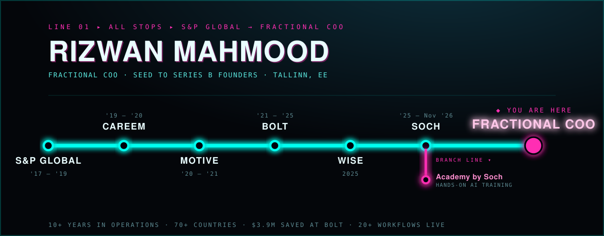

<p align="center">
  
</p>

**Fractional COO for Seed to Series B founders.** I run the operations so you can run the company. I automate only where it earns its place.

10+ years in operations at Careem, Motive, Bolt and Wise. The promise is simple: you're out of day-to-day ops in 90 days, without hiring a full-time COO.

`operating cadence` · `metrics` · `process & handoffs` · `cost & unit economics` · `n8n` · `Anthropic Claude API`

## All stops

| Stop | Years | Role |
|:--|:--|:--|
| **Fractional COO** | Nov '26 – now | consultwithriz.com · you are here |
| **Soch** | Jun '25 – Nov '26 | Co-founder, AI &amp; Ops Transformations |
| **Wise** | May – Nov '25 | Product Manager, Finance Implementation |
| **Bolt** | Oct '21 – May '25 | Global Manager, Operational Excellence → Courier Operations |
| **Motive** | Sep '20 – Sep '21 | Associate Manager, Special Projects, Corporate Strategy |
| **Careem** | Oct '19 – Sep '20 | Country Operations Lead, Delivery · Lead, Growth &amp; Channels |
| **S&amp;P Global** | Apr '17 – May '19 | Associate → Analyst, Client &amp; Product Operations, Insurance |

## Branch line

**Academy by Soch** — hands-on AI training, in the room with a team on their actual work.

## The numbers

| Result | Where it came from |
|:--|:--|
| **$3.9M** | Bolt: courier costs 21% → 14% of GMV in 6 months, 20 countries across Europe &amp; Africa |
| **+$2.1M** | Bolt: A/B-tested delivery fees, in 6 months |
| **8 → 3 days** | Wise: month-end close |
| **~92%** | Wise: straight-through reconciliation, manual journals −65% |
| **70+** | Wise: countries reached through 12+ products and 13+ market launches |
| **3 min → 20s** | Careem: emergency dispatch time, with the Ministry of Health KPK |
| **~40 hrs/week** | Fractional COO: manual work removed per engagement · 20+ workflows live · 7+ clients |

## Terminus

```console
$ riz --who-for
> Seed to Series B founders running operations-heavy companies.
> free fit call → Ops & AI Diagnostic → Fractional COO → Day 90
  [ACCEPTING WORK]

$ contact
> riz@consultwithriz.com
> consultwithriz.com
> linkedin.com/in/consult-with-riz
```

<sub>BSc Applied Accounting, Oxford Brookes University · ACCA · Tallinn, Estonia</sub>
