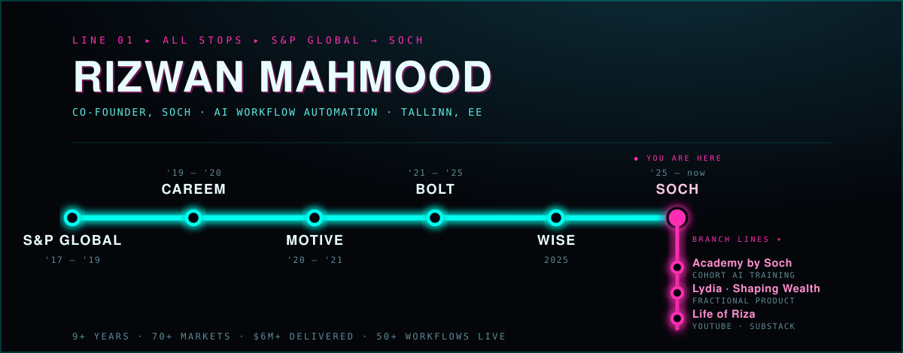

<p align="center">
  <picture>
    <source media="(prefers-color-scheme: dark)" srcset="./assets/line-01-dark.svg">
    <source media="(prefers-color-scheme: light)" srcset="./assets/line-01-light.svg">
    
  </picture>
</p>

**Transformation and product leader.** 9+ years delivering AI, digital and operational transformation inside high-growth technology businesses — Wise, Bolt, Motive, Careem. Now co-founder of **Soch**, an AI workflow automation consultancy running engagements end to end: process discovery, workflow audit, solution design, build, deployment, handover.

I diagnose broken processes, design the target operating model, and ship the tooling — AI agents, automations, reporting — that makes the gain measurable.

---

### ▬ Line 01 · all stops

| Stop | Years | Role |
|:--|:--|:--|
| **Soch** ● | Jun '25 – now | Co-founder, AI & Ops Transformations · leading an org of 12 |
| **Wise** | May – Nov '25 | Product Manager, Finance Implementation |
| **Bolt** | Oct '21 – May '25 | Global Manager, Operational Excellence → Courier Operations |
| **Motive** | Sep '20 – Sep '21 | Associate Manager, Special Projects, Corporate Strategy |
| **Careem** | Oct '19 – Sep '20 | Country Operations Lead, Delivery · Lead, Growth & Channels |
| **S&P Global** | Apr '17 – May '19 | Associate → Analyst, Client & Product Operations, Insurance |

---

### ▬ Branch lines · change here

| Line | Service |
|:--|:--|
| **Academy by Soch** | Cohort-based AI training — non-technical founders and operating teams from zero to automations they own and maintain |
| **Lydia · Shaping Wealth** | Fractional product owner on an AI behavioural coaching platform for financial advisors |
| **Life of Riza** | YouTube, Substack, and Tallinn Tram Takes |

---

### ▬ Service metrics

| | |
|:--|:--|
| `$3.9M` | Courier cost reduced from 21% → 14% of GMV at Bolt, in 6 months, across 20 countries |
| `$2.1M` | Revenue increase from delivery-fee A/B testing, in 6 months |
| `~92%` | Straight-through reconciliation matching shipped at Wise |
| `8 → 3 days` | Month-end close, with manual journals down ~65% |
| `70+` | Markets operating compliantly after 12+ product and 13+ market integrations |
| `50+` | Automations live across 13+ Soch clients, on n8n and the Anthropic Claude API |
| `3min → 20s` | Dispatch time, Careem health service with the Ministry of Health KPK |

---

### ▬ Terminus readout

```console
$ status --line 01
> Soch — AI workflow automation for Seed to Series B startups.
> Engagements: discovery → workflow audit → build → deployment → handover.
> Stack: n8n · Anthropic Claude API · LLM agent design · RAG · Attio · ClickUp
> Also: process mapping, operating model design, KPI & reporting design.
  [ACTIVE]

$ contact
> riz@withsoch.com
> withsoch.com
> linkedin.com/in/consult-with-riz
```

---

<sub>BSc Applied Accounting, Oxford Brookes University · ACCA Affiliate · Tallinn, Estonia</sub>
